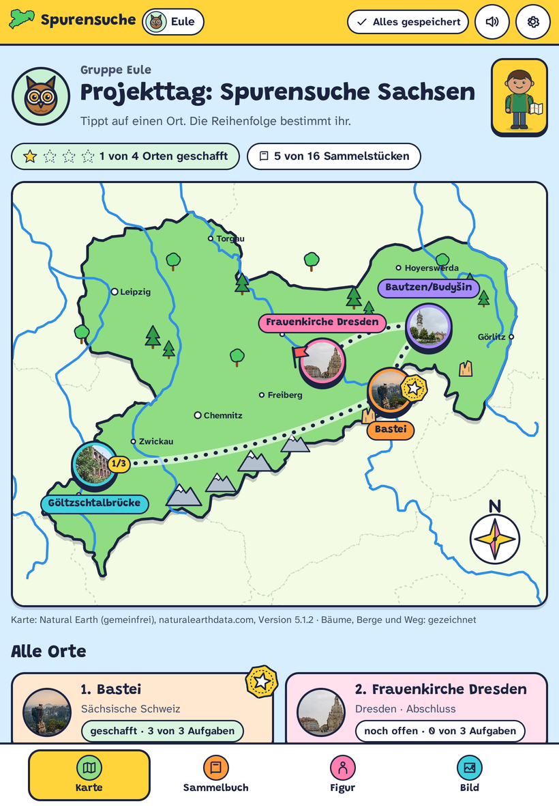
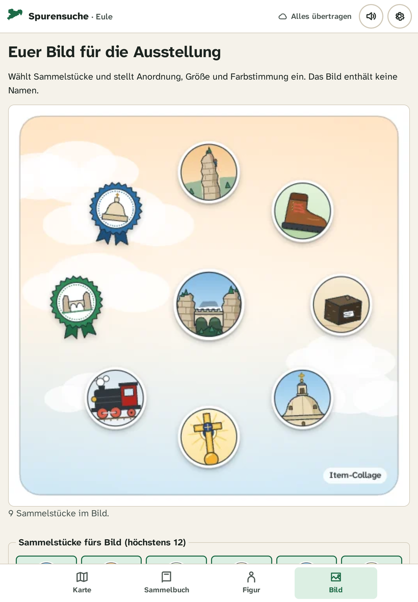

# Spurensuche Sachsen

**Schulklassen und Familien entdecken Orte in Sachsen mit kurzen Spielen, vor Ort oder im Klassenzimmer, auch ohne
Netz. Lehrkräfte sehen, wie ihre Gruppen zusammenarbeiten: ohne Noten und ohne Namen. Das läuft heute, als offener
Prototyp, den Sie selbst ausprobieren und prüfen können.**


<sub>Rundgang aus Sicht einer Schülergruppe: 70 Sekunden, sechs kurze Sätze und ein Abspann, ohne Ton; aufgenommen am
16.11.2026 in der Vorführung (Spielstand teils vorbereitet, Gruppen simuliert).
[Video herunterladen (MP4, 3 MB)](https://github.com/panoherbe/spurensuche/raw/main/medien/rundgang.mp4)
· [Text des Rundgangs](#text-des-rundgangs) weiter unten.</sub>

**Selbst ausprobieren:** die [Vorführung](https://panoherbe.com/projekte/spurensuche/vorfuehrung/index.html) öffnen,
„Mit der Klasse“ wählen und mit dem Code `DEMO-2026` beitreten. In einem zweiten Fenster zeigt „Für Lehrkräfte“ →
„Vorführung ansehen“ die Gruppe live. Alles läuft im Browser; Spielstand und Gruppen bleiben in Ihrem Gerät. Video
und Vorführung auf einer Seite: [panoherbe.com/projekte/spurensuche](https://panoherbe.com/projekte/spurensuche).

<p align="center">
  
  
  
  
</p>

<sub>Bilder im Format iPad hochkant aus den Prüfläufen vom 16.11.2026; Spielstand und Gruppen simuliert.</sub>

## Was Sie brauchen, läuft hier schon

Kurz: Jede Zeile läuft heute im Prototyp. Die Zahlen in der rechten Spalte sind gemessen und belegt; die Nutzerinnen
und Nutzer in den Messungen sind simuliert.

| Sie brauchen | Läuft hier schon | Gemessen am 15. und 16.11.2026 |
|---|---|---|
| Orte auf einer Karte, freie Reihenfolge | Sachsen-Karte aus offenen Daten, vier echte Orte, kein Ort gesperrt | – |
| Kurze Spiele, die sich wiederverwenden lassen | fünf Spielformate, zwölf Aufgaben, ein fester Bauplan für neue Spiele | alle 12 Aufgaben laden im Browser und halten den Bauplan ein, 0 Fehler |
| Spielen ohne Netz | die ganze App und alle Orte liegen im Gerät; Ergebnisse gehen später hinaus, nichts doppelt | 155 Dateien, 4,9 MB im Gerät (nach der Gestaltung für Kinder am 16.11. neu gemessen; im Messlauf 147 Dateien, 4,7 MB); ohne Netz neu geladen und gespielt; in der Prüfinstanz danach ohne Doppelzählung übertragen |
| Vor Ort oder im Klassenzimmer | QR-Code, Code vom Schild oder Standort; je Ort eine Fassung für die Schule | QR-Codes von fremder Software (zbar) gelesen: 17 von 17 |
| Sammeln und ein eigenes Bild | Sammelbuch zeigt, wo es was gibt (kein Zufall); Bild 2048 × 2048 aus den Sammelstücken, mit Reglern | Test: Schule wartet auf die Freigabe, die Ausstellung sieht nur Freigegebenes |
| Auswertung für Lehrkräfte | Gruppen, Freigabe, laufende Übersicht, Beobachtungen, Kompetenzraster, PDF-Bericht, Textentwürfe, Löschen | 33 von 33 automatischen Tests bestanden (am 16.11. erneut 33 von 33) |
| Datenschutz | keine Daten über einzelne Kinder; Familien ohne Konto; Gruppendaten nach zwölf Wochen gelöscht | Test: Name und E-Mail der Schulanmeldung werden nie gespeichert |
| Barrierefreiheit | Vorlesen, einfache Sprache, Tempo, hoher Kontrast, dunkel, große Schrift | 0 von axe-core 4.10.2 gefundene Verstöße (WCAG 2.1 AA) in 77 Ansichten; nach der Gestaltung für Kinder am 16.11. erneut 77 Ansichten, 0 Verstöße; dazu jedes Spiel nur mit der Tastatur in drei Browsern: 537 Zustände, 0 Verstöße (bis WCAG 2.2 AA) |
| Schulanmeldung | Standard OpenID Connect; fällt der Dienst aus, läuft die Stunde weiter | gegen Keycloak 26.0 geprüft: 5 von 5 Fällen ([Probelauf](nachweis/2026-11-15/keycloak/keycloak.json)); Ausfall und Schlüsselwechsel im Test |
| Bilder für die Ausstellung | Freigabe durch die Lehrkraft, offene Schnittstelle, Archiv im offenen Format BagIt | Archiv: 99 Dateien exportiert, in eine leere Instanz übernommen und wieder exportiert, alle 99 Prüfsummen gleich (in diesem Lauf ohne Bildbeiträge) |
| Viele Klassen zugleich | ein kleiner Server (2 CPU-Kerne, 2 GB) | 400 simulierte Gruppen gleichzeitig, 45 Minuten: 105.566 Anfragen, 0 Fehler; 95 % der Übertragungen in 2 ms, 99 % in 17 ms; mit 600 Gruppen: 0 Fehler |
| Betrieb ohne uns | ein Container-Image für die App und die tägliche verschlüsselte Sicherung, ein kleiner Betriebsdienst am Server, Anleitung, Export im offenen Archivformat | frischer Klon → laufende Instanz in 2,3 s (Basis-Image lag vor); Sicherung zurückgespielt: alle 19 Tabellen mit gleicher Prüfsumme |
| Betrieb ohne Entwicklerwissen | Betriebsseite mit Ampel (jeder Punkt sagt „Was tun“) und vier Knöpfen: Neu starten, Sicherung zurückspielen, Inhalt tauschen, Letzte Version zurückspielen; Handbuch für den Telefondienst | Knöpfe im Prüflauf gedrückt: wieder erreichbar nach 1,0 s, Sicherung zurückgespielt (Meldung nach 1,1 s), letzte Version zurück in 31,1 s; mit dem Werkzeug am Server: Zurückspielen 12,2 s; eine absichtlich defekte Prüfversion wurde nach 114 s automatisch zurückgenommen (simuliert) |

Belege: das [Messprotokoll vom 15.11.2026](nachweis/2026-11-15-gesamt/PROTOKOLL.md), die
[Nachmessung vom 16.11.2026 nach der Gestaltung für Kinder](nachweis/2026-11-16-kinder/LIESMICH.md) und die
[Nachmessung nach den letzten Korrekturen, ebenfalls 16.11.2026](nachweis/2026-11-16-kinder-2/LIESMICH.md).
Simuliert heißt: Ein Programm spielt die Nutzerinnen und Nutzer nach, im Browser oder direkt am Server.

Ein MB sind hier 1.000.000 Byte: Das Paket mit 155 Dateien hat 4.915.380 Byte (letzte Nachmessung), das mit 147
Dateien im Messlauf 4.721.242 Byte. Die Belege und die Info-Seite der App rechnen mit 1.048.576 Byte je MB und zeigen
deshalb 4,7 und 4,5 MB.

## In zwei Minuten selbst prüfen

Kurz: am schnellsten im Browser, ohne Konto und ohne Installation; wer mag, startet die App mit Docker auf dem eigenen
Rechner oder lässt die Tests laufen.

1. **Im Browser:** die [Vorführung](https://panoherbe.com/projekte/spurensuche/vorfuehrung/index.html) mit
   Beispielklasse, ohne Server.
2. **Auf dem eigenen Rechner** (Linux mit Docker):

   ```bash
   git clone https://github.com/panoherbe/spurensuche.git && cd spurensuche
   betrieb/spur einrichten
   ```

   Dann `http://localhost:8080` öffnen. Das Werkzeug legt die Einstellungsdatei `.env` an, erzeugt alle Schlüssel
   (der Schlüssel der Verwaltung steht dort unter `SPUR_VERWALTUNG_SCHLUESSEL`), baut und startet. Wie es weitergeht:
   [`docs/INSTALLATION.md`](docs/INSTALLATION.md).
3. **Die Tests laufen lassen** (Docker, ohne Installation von Node.js):

   ```bash
   docker run --rm -v "$PWD":/app -w /app node:24-alpine node --test test/*.test.js
   ```

## Was Sie heute schon prüfen können

Kurz: Code, Messwerte, Tests und Unterlagen für den Betrieb liegen schon offen.

Den ganzen Quellcode, das Messprotokoll mit allen Zahlen, die Tests und die Unterlagen für den Betrieb: Installation,
Betriebshandbuch für den Telefondienst, technischer Betrieb, Datenschutz, Anmeldung, Regeln der Auswertung,
Schnittstelle (OpenAPI), Fehlerkatalog. Die Betriebsseite lässt sich in der Vorführung anklicken
([betrieb.html](https://panoherbe.com/projekte/spurensuche/vorfuehrung/betrieb.html), Schlüssel `BETRIEB-DEMO`; die
Werte dort sind nachgebildet).

## Text des Rundgangs

Kurz: die Sätze im Video zum Nachlesen. Sechs Szenen, je ein Satz, danach der Abspann. Rechts unten steht die ganze
Zeit: Selbst ausprobieren, panoherbe.com/projekte/spurensuche.

| ab | Satz | Was man sieht |
|---|---|---|
| 0:00 | Die Karte zeigt eure Orte. | die Karte der Gruppe mit vier Orten |
| 0:06 | Ihr wählt einen Ort. | die Gruppe tippt auf die Bastei, der Ort mit Foto und kurzem Text |
| 0:15 | Ihr löst ein Rätsel im Team. | ein Bildpuzzle: zwei Teile antippen, sie tauschen die Plätze |
| 0:33 | Dafür gibt es ein Sammelstück. | Sterne, das Sammelstück, es klebt sich ins Sammelbuch |
| 0:46 | Am Ende baut ihr ein Bild. *(klein darunter: Spielstand für den Rundgang vorbereitet.)* | alle Orte geschafft, das Bild aus den Sammelstücken, eine andere Anordnung |
| 1:00 | Lehrkräfte sehen Gruppen, nie einzelne Kinder. *(klein darunter: Beispielklasse, Gruppen simuliert.)* | die laufende Übersicht der Lehrkraft |
| 1:07 | Abspann: Selbst ausprobieren. panoherbe.com/projekte/spurensuche. Im Browser, ohne Konto. | darunter: Panagiotis Herbe · Code AGPL-3.0-only · Texte und Zeichnungen CC BY-SA 4.0 · Fotos: Wikimedia Commons, Urheber und Lizenz je Bild im Repository |

## Was der Prototyp noch nicht ist

Kurz: ein Prototyp mit Beispielinhalten. Echte Inhalte, die Schulanmeldung des Betreibers, Prüfungen von außen und
eigene Illustrationen kommen in einem Projekt dazu.

- **Inhalte:** vier Beispielorte mit eigenen Texten und freien Fotos. Die Inhalte eines echten Projekts kommen von der
  Fachseite und werden über dasselbe Format eingespielt.
- **Schulanmeldung:** gegen einen Testanbieter (Keycloak) geprüft. Die Vorgaben des Betreibers werden im Projekt
  eingebaut.
- **QR-Code in der App:** nutzt die eingebaute Erkennung des Browsers (etwa Chrome auf Android, ChromeOS und macOS).
  Sonst, etwa auf Windows-Laptops, dem iPad und in Firefox, liest die Kamera-App den Code, oder die Gruppe tippt den
  Code vom Schild ein.
- **Prüfungen von außen:** axe-core findet nur einen Teil der Barrierefreiheitsprobleme; ein Audit nach EN 301 549 und
  ein Penetrationstest gehören zu einem Projekt.
- **Lasttest:** Server und Netz liefen im selben Rechner; Funknetze an Schulen und echte Endgeräte waren nicht Teil der
  Messung.
- **Gestaltung:** Figuren und Grafiken des Prototyps; eigene Illustrationen entstehen im Projekt.

## Kontakt

Panagiotis Herbe · kontakt [at] panoherbe.com · [panoherbe.com](https://panoherbe.com)

---

## Für Ihre IT

Kurz: Progressive Web App und ein kleiner Server mit SQLite, beides ohne Fremdbibliotheken (Node.js 24, keine
npm-Pakete zur Laufzeit); ein Container-Image für App und Sicherung, dazu ein kleiner Betriebsdienst; alle Daten
exportierbar.

- Aufbau: [`docs/ARCHITEKTUR.md`](docs/ARCHITEKTUR.md)
- Installation und Betrieb: [`docs/INSTALLATION.md`](docs/INSTALLATION.md), [`docs/BETRIEB.md`](docs/BETRIEB.md),
  [`docs/KONFIGURATION.md`](docs/KONFIGURATION.md), Handbuch für den Telefondienst
  [`docs/BETRIEBSHANDBUCH.md`](docs/BETRIEBSHANDBUCH.md)
- Datenschutz und Anmeldung: [`docs/DATENSCHUTZ.md`](docs/DATENSCHUTZ.md), [`docs/ANMELDUNG.md`](docs/ANMELDUNG.md)
- Auswertung: [`docs/AUSWERTUNG.md`](docs/AUSWERTUNG.md)
- Schnittstellen: [`docs/openapi.json`](docs/openapi.json) (OpenAPI 3.1),
  [`docs/SCHNITTSTELLE.md`](docs/SCHNITTSTELLE.md) (Spiele und Inhalte), [`docs/FEHLERKATALOG.md`](docs/FEHLERKATALOG.md)
- Abhängigkeiten und Lizenzen: [`docs/ABHAENGIGKEITEN.md`](docs/ABHAENGIGKEITEN.md)
- Tests: `docker run --rm -v "$PWD":/app -w /app node:24-alpine node --test test/*.test.js`; Browser-Prüfläufe,
  Lasttest und der ganze Messlauf: [`docs/TESTUMGEBUNG.md`](docs/TESTUMGEBUNG.md), `tools/messlauf.sh`
- Nachweise: [`nachweis/2026-11-16-kinder-2/`](nachweis/2026-11-16-kinder-2/LIESMICH.md) (letzte Korrekturen an Karte,
  Vorführung und Sammelbild, `5e1df13`: Tests, Browser-Prüfläufe und Prüflauf der Spiele erneut, 33 von 33,
  77 Ansichten ohne Verstoß, Spiele 81 von 81 ohne Überlauf, Paket 155 Dateien, Bilder und Rundgang mit Abspann neu),
  [`nachweis/2026-11-16-kinder/`](nachweis/2026-11-16-kinder/LIESMICH.md) (Gestaltung für Kinder, `1cffbad`:
  Tests, alle Browser-Prüfläufe des Messlaufs und der Prüflauf der Spiele erneut, 33 von 33, 77 Ansichten ohne Verstoß,
  Spiele 81 von 81 gelöst und ohne Überlauf, Paket 155 Dateien, Bilder und Rundgang neu),
  [`nachweis/2026-11-15-gesamt/`](nachweis/2026-11-15-gesamt/) (offizieller Messlauf, Code-Stand: Tag
  `messlauf-2026-11-15`; spätere Commits änderten Texte, Lizenzangaben und die Bremse gegen das Durchprobieren von
  Codes, die Tests liefen danach erneut mit 33 von 33), [`nachweis/2026-11-15-gestaltung/`](nachweis/2026-11-15-gestaltung/)
  (neue Gestaltung mit eigener Schrift, `b34b4bd`: Tests und alle Browser-Prüfläufe des Messlaufs erneut, 33 von 33,
  77 Ansichten ohne Verstoß, Paket 150 Dateien, Bilder neu),
  [`nachweis/2026-11-15-konzeptbilder/`](nachweis/2026-11-15-konzeptbilder/) (Nachlauf zweier Bilder),
  [`nachweis/2026-11-15/`](nachweis/2026-11-15/) (Probeläufe)

**Lizenz:** © 2026 Panagiotis Herbe. Programmcode GNU AGPL-3.0-only seit dem ersten Commit ([`LICENSE`](LICENSE));
Texte, Aufgaben und eigene Zeichnungen CC BY-SA 4.0; Fotos der Orte aus Wikimedia Commons unter freien Lizenzen, je
Bild in [`inhalte/BILDNACHWEIS.md`](inhalte/BILDNACHWEIS.md); Karte nach Natural Earth (gemeinfrei); Schriften
Atkinson Hyperlegible Next (Lesetext) und Grandstander (Überschriften und Knöpfe), beide SIL Open Font License 1.1.
Auftraggeber erhalten im Auftrag die vertraglich vereinbarten Rechte.
