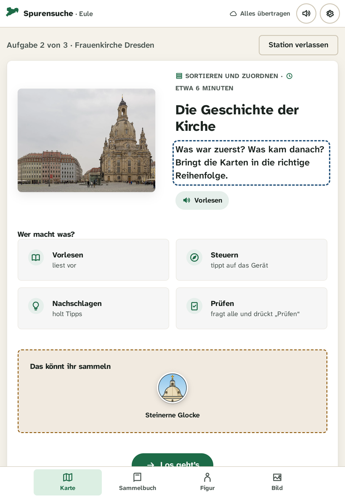
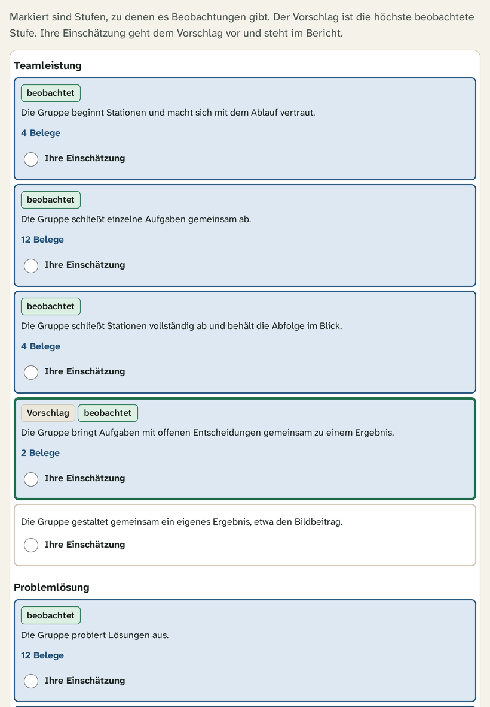

# Spurensuche Sachsen

**Schulklassen und Familien entdecken Orte in Sachsen mit kurzen Spielen, vor Ort oder im Klassenzimmer, auch ohne
Netz. Lehrkräfte sehen, wie ihre Gruppen zusammenarbeiten: ohne Noten und ohne Namen. Das läuft heute, als offener
Prototyp, den Sie selbst ausprobieren und prüfen können.**


<sub>Rundgang, 90 Sekunden, ohne Ton, mit Untertiteln; aufgenommen am 15.11.2026 in der Vorführung (Beispielklasse,
Gruppen simuliert). [Video herunterladen (MP4, 2,9 MB)](https://github.com/panoherbe/spurensuche/raw/main/medien/rundgang.mp4)
· Text des Rundgangs weiter unten.</sub>

**Selbst ausprobieren:** die [Vorführung](https://panoherbe.com/projekte/spurensuche/vorfuehrung/index.html) öffnen,
„Mit der Klasse“ wählen und mit dem Code `DEMO-2026` beitreten. In einem zweiten Fenster zeigt „Für Lehrkräfte“ →
„Vorführung ansehen“ die Gruppe live. Alles läuft im Browser; nichts wird übertragen.

<p align="center">
  
  
  
  
</p>

<sub>Bilder im Format iPad hochkant aus den Prüfläufen vom 15.11.2026; Spielstand und Gruppen simuliert.</sub>

## Was Sie brauchen, läuft hier schon

Kurz: Jede Zeile ist im Prototyp umgesetzt. Jede Zahl steht mit Datum im Messprotokoll
[`nachweis/2026-11-15-gesamt/PROTOKOLL.md`](nachweis/2026-11-15-gesamt/PROTOKOLL.md), die Nachmessung nach der neuen
Gestaltung in [`nachweis/2026-11-15-gestaltung/`](nachweis/2026-11-15-gestaltung/). Alle Nutzerinnen und Nutzer in
den Messungen sind simuliert: Ein Skript klickt im Browser oder schickt Anfragen.

| Sie brauchen | Läuft hier schon | Gemessen am 15.11.2026 |
|---|---|---|
| Orte auf einer Karte, freie Reihenfolge | Sachsen-Karte aus offenen Daten, vier echte Orte, kein Ort gesperrt | – |
| Kurze Spiele, die sich wiederverwenden lassen | fünf Spielformate, zwölf Aufgaben, ein fester Bauplan für neue Spiele | alle 12 Aufgaben laden im Browser und halten den Bauplan ein, 0 Fehler |
| Spielen ohne Netz | die ganze App und alle Orte liegen im Gerät; Ergebnisse gehen später hinaus, nichts doppelt | 150 Dateien, 4,6 MB im Gerät (nach der Gestaltung vom 15.11. abends neu gemessen; im Messlauf 147 Dateien, 4,5 MB); ohne Netz neu geladen und gespielt; in der Prüfinstanz danach ohne Doppelzählung übertragen |
| Vor Ort oder im Klassenzimmer | QR-Code, Code vom Schild oder Standort; je Ort eine Fassung für die Schule | QR-Codes von fremder Software (zbar) gelesen: 17 von 17 |
| Sammeln und ein eigenes Bild | Sammelbuch zeigt, wo es was gibt (kein Zufall); Bild 2048 × 2048 aus den Sammelstücken, mit Reglern | Test: Schule wartet auf die Freigabe, die Ausstellung sieht nur Freigegebenes |
| Auswertung für Lehrkräfte | Gruppen, Freigabe, laufende Übersicht, Beobachtungen, Kompetenzraster, PDF-Bericht, Textentwürfe, Löschen | 33 von 33 automatischen Tests bestanden |
| Datenschutz | keine Daten über einzelne Kinder; Familien ohne Konto; Gruppendaten nach zwölf Wochen gelöscht | Test: Name und E-Mail der Schulanmeldung werden nie gespeichert |
| Barrierefreiheit | Vorlesen, einfache Sprache, Tempo, hoher Kontrast, dunkel, große Schrift | 0 von axe-core 4.10.2 gefundene Verstöße (WCAG 2.1 AA) in 77 Ansichten; nach der neuen Gestaltung vom selben Abend erneut 77 Ansichten, 0 Verstöße |
| Schulanmeldung | Standard OpenID Connect; fällt der Dienst aus, läuft die Stunde weiter | gegen Keycloak 26.0 geprüft: 5 von 5 Fällen ([Probelauf](nachweis/2026-11-15/keycloak/keycloak.json)); Ausfall und Schlüsselwechsel im Test |
| Bilder für die Ausstellung | Freigabe durch die Lehrkraft, offene Schnittstelle, Archiv im offenen Format BagIt | Archiv: 99 Dateien exportiert, in eine leere Instanz übernommen und wieder exportiert, alle 99 Prüfsummen gleich (in diesem Lauf ohne Bildbeiträge) |
| Viele Klassen zugleich | ein kleiner Server (2 CPU-Kerne, 2 GB) | 400 simulierte Gruppen gleichzeitig, 45 Minuten: 105.566 Anfragen, 0 Fehler; 95 % der Übertragungen in 2 ms, 99 % in 17 ms; mit 600 Gruppen: 0 Fehler |
| Betrieb ohne uns | ein Container, Anleitung, tägliche verschlüsselte Sicherung, Export im offenen Archivformat | frischer Klon → laufende Instanz in 2,3 s (Basis-Image lag vor); Sicherung zurückgespielt: alle 19 Tabellen mit gleicher Prüfsumme |
| Betrieb ohne Entwicklerwissen | Betriebsseite mit Ampel (jeder Punkt sagt „Was tun“) und vier Knöpfen: Neu starten, Sicherung zurückspielen, Inhalt tauschen, Letzte Version zurückspielen; Handbuch für den Telefondienst | Knöpfe im Prüflauf gedrückt: wieder erreichbar nach 1,0 s, Sicherung zurückgespielt (Meldung nach 1,1 s), letzte Version zurück in 31,1 s; mit dem Werkzeug am Server: Zurückspielen 12,2 s; eine absichtlich defekte Prüfversion wurde nach 114 s automatisch zurückgenommen (simuliert) |

## In zwei Minuten selbst prüfen

1. **Im Browser:** die [Vorführung](https://panoherbe.com/projekte/spurensuche/vorfuehrung/index.html) mit
   Beispielklasse, ohne Server.
2. **Auf dem eigenen Rechner** (Linux mit Docker):

   ```bash
   git clone https://github.com/panoherbe/spurensuche.git && cd spurensuche
   betrieb/spur einrichten
   ```

   Dann `http://localhost:8080` öffnen. Das Werkzeug legt die Einstellungsdatei `.env` an, erzeugt alle Schlüssel
   (der Schlüssel der Verwaltung steht dort unter `SPUR_VERWALTUNG_SCHLUESSEL`), baut und startet. Wie es weitergeht:
   [`docs/INSTALLATION.md`](docs/INSTALLATION.md).
3. **Die Tests laufen lassen** (Docker, ohne Installation von Node.js):

   ```bash
   docker run --rm -v "$PWD":/app -w /app node:24-alpine node --test test/*.test.js
   ```

## Was Sie heute schon prüfen können

Den ganzen Quellcode, das Messprotokoll mit allen Zahlen, die Tests und die Unterlagen für den Betrieb: Installation,
Betriebshandbuch für den Telefondienst, technischer Betrieb, Datenschutz, Anmeldung, Regeln der Auswertung,
Schnittstelle (OpenAPI), Fehlerkatalog. Die Betriebsseite lässt sich in der Vorführung anklicken
([betrieb.html](https://panoherbe.com/projekte/spurensuche/vorfuehrung/betrieb.html), Schlüssel `BETRIEB-DEMO`; die
Werte dort sind nachgebildet).

<details>
<summary><b>Text des Rundgangs</b> (die Untertitel des Videos)</summary>

| ab | Untertitel |
|---|---|
| 0:00 | **Titel:** Sachsen entdecken, in der Gruppe, auch ohne Netz. Kurze Spiele an Orten, für Schulklassen und Familien. |
| 0:06 | Jede Gruppe tritt mit einem Code bei. Keine Namen, keine Konten. |
| 0:15 | Die Karte zeigt die Orte. Die Reihenfolge wählt die Gruppe, kein Ort ist gesperrt. |
| 0:22 | Vor Ort bestätigt die Gruppe den Besuch mit Code oder Standort. Im Klassenzimmer gibt es eine eigene Fassung. |
| 0:31 | Kurze Spiele, fünf bis zehn Minuten, hier in einfacher Sprache. Jede Person hat eine Rolle. |
| 0:38 | Zum Schluss gestaltet die Gruppe aus ihren Sammelstücken ein Bild für die Ausstellung. (Spielstand für den Rundgang vorbereitet.) |
| 0:46 | Die Lehrkraft sieht live, an welchem Ort ihre Gruppen gerade sind. (Beispielklasse der Vorführung, Gruppen simuliert.) |
| 0:53 | Danach Beobachtungen im Kompetenzraster, mit Vorschlag und Belegen. (Beispielklasse der Vorführung, Gruppen simuliert.) |
| 0:59 | Keine Noten, keine Rangfolge. Die Einschätzung trifft die Lehrkraft. (Beispielklasse der Vorführung, Gruppen simuliert.) |
| 1:05 | Für den Betrieb: eine Ampel, die sagt, was zu tun ist, und vier sichere Knöpfe. (In der Vorführung sind die Werte nachgebildet.) |
| 1:13 | **Gemessen am 15.11.2026:** 33 von 33 Tests bestanden · 400 Gruppen gleichzeitig, 0 Fehler (simuliert) · 4,6 MB: alle Orte im Gerät, ohne Netz · 0 Verstöße: Barrierefreiheit, WCAG 2.1 AA. Alle Gruppen in Lasttest und Prüfläufen sind simuliert. |
| 1:22 | **Selbst ausprobieren:** panoherbe.com/projekte/spurensuche. Im Browser, ohne Konto. (Code AGPL-3.0: github.com/panoherbe/spurensuche · Texte und Zeichnungen CC BY-SA 4.0 · Fotos der Orte: Wikimedia Commons, Urheber und Lizenz je Bild im Repository) |

</details>

## Was der Prototyp noch nicht ist

- **Inhalte:** vier Beispielorte mit eigenen Texten und freien Fotos. Die Inhalte eines echten Projekts kommen von der
  Fachseite und werden über dasselbe Format eingespielt.
- **Schulanmeldung:** gegen einen Testanbieter (Keycloak) geprüft. Die Vorgaben des Betreibers werden im Projekt
  eingebaut.
- **QR-Code in der App:** nutzt die eingebaute Erkennung des Browsers (Chrome, Edge, Android, ChromeOS). Auf dem iPad
  und in Firefox liest die Kamera-App den Code, oder die Gruppe tippt den Code vom Schild ein.
- **Prüfungen von außen:** axe-core findet nur einen Teil der Barrierefreiheitsprobleme; ein Audit nach EN 301 549 und
  ein Penetrationstest gehören zu einem Projekt.
- **Lasttest:** Server und Netz liefen im selben Rechner; Funknetze an Schulen und echte Endgeräte waren nicht Teil der
  Messung.
- **Gestaltung:** Figuren und Grafiken des Prototyps; eigene Illustrationen entstehen im Projekt.

## Kontakt

[panoherbe.com](https://panoherbe.com)

---

## Für Ihre IT

Kurz: Progressive Web App und ein kleiner Server mit SQLite, beides ohne Fremdbibliotheken (Node.js 24, keine
npm-Pakete zur Laufzeit); ein Container; alle Daten exportierbar.

- Aufbau: [`docs/ARCHITEKTUR.md`](docs/ARCHITEKTUR.md)
- Installation und Betrieb: [`docs/INSTALLATION.md`](docs/INSTALLATION.md), [`docs/BETRIEB.md`](docs/BETRIEB.md),
  [`docs/KONFIGURATION.md`](docs/KONFIGURATION.md), Handbuch für den Telefondienst
  [`docs/BETRIEBSHANDBUCH.md`](docs/BETRIEBSHANDBUCH.md)
- Datenschutz und Anmeldung: [`docs/DATENSCHUTZ.md`](docs/DATENSCHUTZ.md), [`docs/ANMELDUNG.md`](docs/ANMELDUNG.md)
- Auswertung: [`docs/AUSWERTUNG.md`](docs/AUSWERTUNG.md)
- Schnittstellen: [`docs/openapi.json`](docs/openapi.json) (OpenAPI 3.1),
  [`docs/SCHNITTSTELLE.md`](docs/SCHNITTSTELLE.md) (Spiele und Inhalte), [`docs/FEHLERKATALOG.md`](docs/FEHLERKATALOG.md)
- Abhängigkeiten und Lizenzen: [`docs/ABHAENGIGKEITEN.md`](docs/ABHAENGIGKEITEN.md)
- Tests: `docker run --rm -v "$PWD":/app -w /app node:24-alpine node --test test/*.test.js`; Browser-Prüfläufe,
  Lasttest und der ganze Messlauf: [`docs/TESTUMGEBUNG.md`](docs/TESTUMGEBUNG.md), `tools/messlauf.sh`
- Nachweise: [`nachweis/2026-11-15-gesamt/`](nachweis/2026-11-15-gesamt/) (offizieller Messlauf, Code-Stand: Tag
  `messlauf-2026-11-15`; spätere Commits änderten Texte, Lizenzangaben und die Bremse gegen das Durchprobieren von
  Codes, die Tests liefen danach erneut mit 33 von 33), [`nachweis/2026-11-15-gestaltung/`](nachweis/2026-11-15-gestaltung/)
  (neue Gestaltung mit eigener Schrift, `b34b4bd`: Tests und alle Browser-Prüfläufe des Messlaufs erneut, 33 von 33,
  77 Ansichten ohne Verstoß, Paket 150 Dateien, Bilder neu),
  [`nachweis/2026-11-15-konzeptbilder/`](nachweis/2026-11-15-konzeptbilder/) (Nachlauf zweier Bilder),
  [`nachweis/2026-11-15/`](nachweis/2026-11-15/) (Probeläufe)

**Lizenz:** Programmcode GNU AGPL-3.0-only seit dem ersten Commit ([`LICENSE`](LICENSE)); Texte, Aufgaben und eigene
Zeichnungen CC BY-SA 4.0; Fotos der Orte aus Wikimedia Commons unter freien Lizenzen, je Bild in
[`inhalte/BILDNACHWEIS.md`](inhalte/BILDNACHWEIS.md); Karte nach Natural Earth (gemeinfrei); Schrift Atkinson
Hyperlegible Next (SIL Open Font License 1.1). Auftraggeber erhalten im
Auftrag die vertraglich vereinbarten Rechte.
