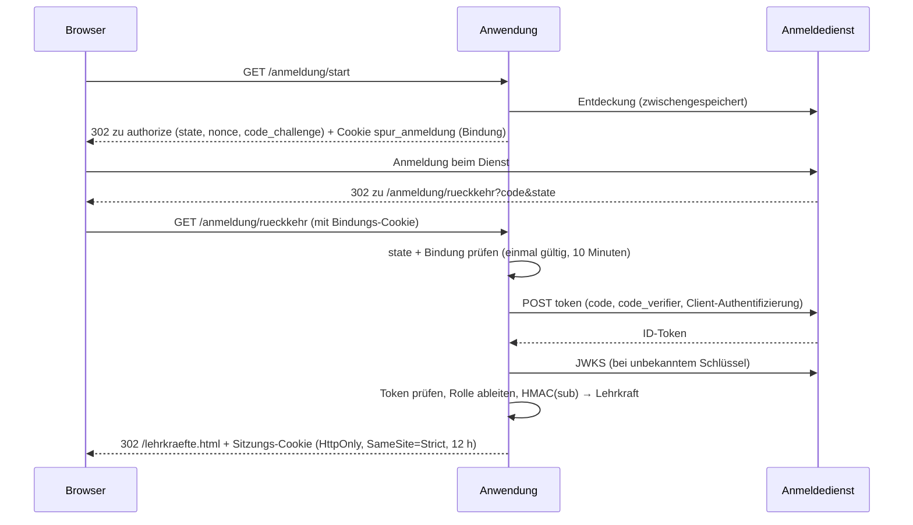
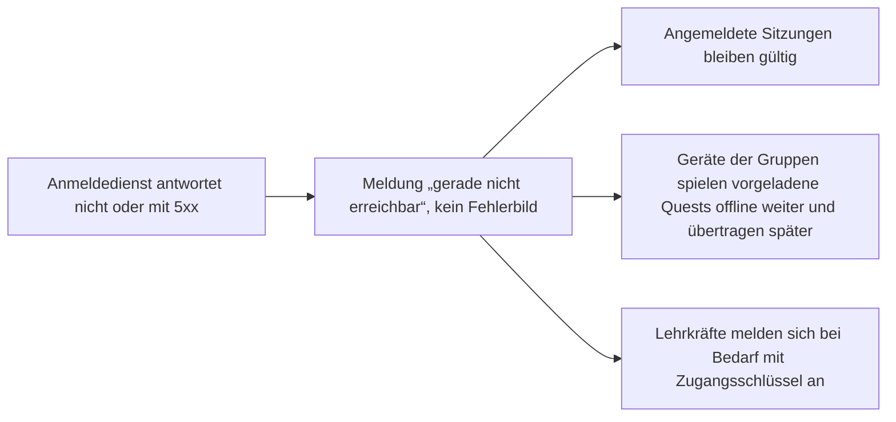

# Anmeldung

Kurz: Die Anwendung spricht OpenID Connect (Authorization Code Flow mit PKCE), den Standard, den schulische
Anmeldedienste anbieten. Vom Anmeldedienst nutzt sie genau zwei Merkmale: das Pseudonym (`sub`) und die Rolle. Für
Lehrkräfte bleibt ein HMAC des Pseudonyms, für Lernende nichts. Fällt der Dienst aus, laufen begonnene Quests
weiter. Bis zur Anbindung melden sich Lehrkräfte mit einem Zugangsschlüssel an. Getestet wird gegen eine Attrappe
(`server/attrappe.js`), die sich wie ein echter Anbieter verhält, und gegen Keycloak 26 als unabhängigen Anbieter
(`compose.keycloak.yaml`, Prüflauf `test/keycloak.js`: Lehrkraft, Lernende, Konto ohne Rolle, zentrale Abmeldung,
keine Namen und E-Mails in der Datenbank). Die Vorgaben eines bestimmten Anmeldedienstes (Merkmale, Rollen,
Abmeldung) kommen beim Anbinden über die Konfiguration hinzu.

## Integrationsbeschreibung

| Punkt | Umsetzung |
|---|---|
| Verfahren | OpenID Connect Core 1.0, Authorization Code Flow, PKCE mit S256, `state` (an das Browserfenster gebunden), `nonce` |
| Anwendungstyp | vertraulicher Client, Authentifizierung `client_secret_basic` |
| Rücksprungadresse | `<SPUR_OEFFENTLICHE_URL>/anmeldung/rueckkehr` |
| Abmeldung | lokal sofort; zentral über `end_session_endpoint` mit `client_id` und `post_logout_redirect_uri`, falls der Anbieter ihn nennt |
| Entdeckung | `<Aussteller>/.well-known/openid-configuration`, eine Stunde zwischengespeichert |
| Signatur | RS256; Schlüssel über `jwks_uri`; unbekannte Schlüsselkennung → JWKS einmal neu laden (Schlüsselwechsel ohne Neustart, getestet) |
| Prüfungen des ID-Tokens | Signatur, `iss`, `aud` (und `azp` bei mehreren), `exp` (60 s Toleranz), `iat` nicht in der Zukunft, `nonce` |
| Einstellungen | `SPUR_OIDC_AUSSTELLER`, `SPUR_OIDC_CLIENT_ID`, `SPUR_OIDC_CLIENT_SECRET`, `SPUR_OIDC_ROLLEN_MERKMAL`, `SPUR_OIDC_ROLLEN_LEHRKRAFT`, `SPUR_OIDC_ROLLEN_LERNENDE` (docs/KONFIGURATION.md) |
| Zeitlimit | 8 Sekunden je Aufruf beim Anbieter |
| Schlüssel der Anwendung | nur das Client-Geheimnis in `.env`; Wechsel durch Austausch und Neustart |

## Merkmalstabelle

| Merkmal | Verwendung | Verarbeitungsdauer | gespeichert |
|---|---|---|---|
| `sub` | Lehrkraft: wiedererkennen (Lerngruppen gehören ihr) | während der Anmeldung | nur als HMAC-SHA256 über Aussteller und `sub` mit geheimem Schlüssel der Instanz; Lernende: **nein** |
| Rolle (`rolle`, einstellbar) | Rolle in der Anwendung: Lehrkraft oder Lernende | während der Anmeldung | **nein** (nur die abgeleitete Rolle in der Sitzung, bis zu ihrem Ablauf) |
| `iss`, `aud`, `exp`, `iat`, `nonce`, `azp` | Prüfung des Tokens | während der Anmeldung | **nein** |
| `name`, `email`, `schule`, `klasse` und alle übrigen | nicht verwendet | werden in `server/oidc.js` verworfen | **nein** (Test durchsucht die Datenbankdatei) |

## Abläufe

### Anmeldung einer Lehrkraft

### Lernende

Wie oben; nach der Prüfung entsteht eine Sitzung mit der Rolle „Lernende“ ohne jeden Bezug zur Person. Danach gibt
die Gruppe den Code ihrer Lehrkraft ein. Mit `SPUR_LERNENDE_ANMELDUNG=pflicht` ist der Beitritt nur mit dieser
Sitzung möglich; Standard ist `optional` (Einwilligungslösung bis zur Anbindung).

### Abmeldung

`POST /api/v1/abmeldung` löscht die Sitzung sofort und liefert die Adresse der zentralen Abmeldung, falls der
Anbieter sie nennt; die Oberfläche leitet dorthin weiter.

### Rollenwechsel

Eine Sitzung hat genau eine Rolle. Wer die Rolle wechselt (anderes Konto), meldet sich ab und neu an.

### Ausfall des Anmeldedienstes

Getestet mit der Attrappe (`POST /attrappe/ausfall?an=1`): Die Anmeldung leitet mit `fehler=nicht-erreichbar` auf
eine verständliche Meldung, die Anmeldung mit Zugangsschlüssel funktioniert weiter.

## Zugangsschlüssel (Erprobung ohne Anmeldedienst)

Die Verwaltung legt je Lehrkraft einen Schlüssel an (`/verwaltung.html`); er erscheint nur einmal, gespeichert wird
sein SHA-256. Gesperrte Schlüssel melden sofort ab. Die Lehrkraft ist dann der HMAC über die Nummer des Schlüssels.

## Weitere Identitätsanbieter

Ein zweiter Anbieter (z. B. ein länderübergreifender Dienst) ist ein weiterer OpenID-Connect-Client derselben Art:
`server/oidc.js` wird mit einer zweiten Konfiguration erzeugt; am Ablauf der Anmeldung ändert sich nichts.
